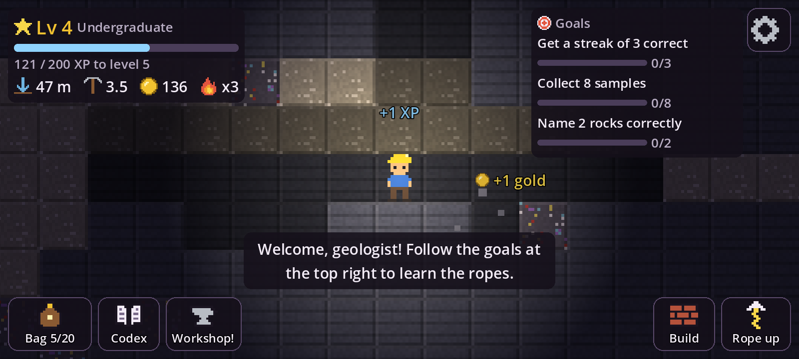
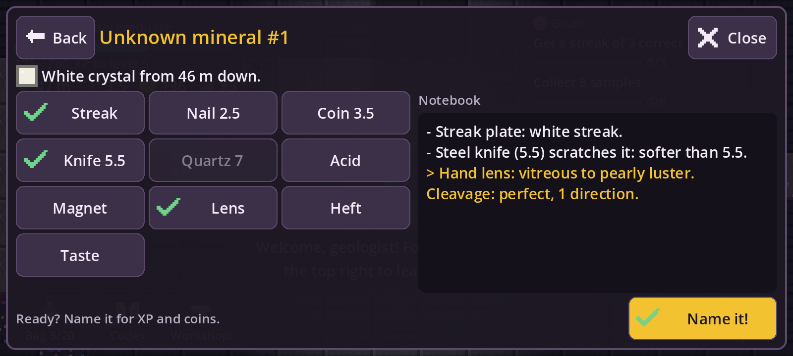
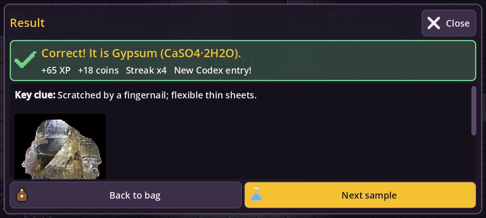
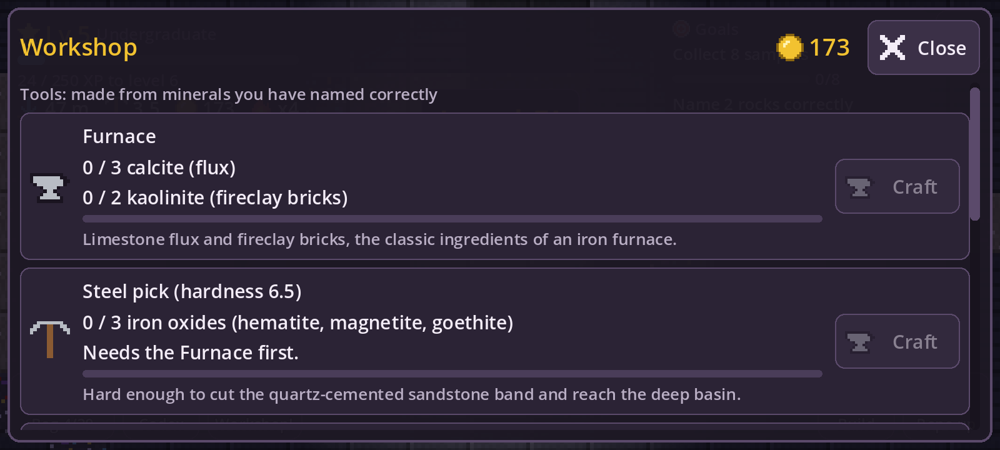

# Deep Strata (Geology-game)

An 8-bit 2D mining game for Android that teaches mineralogy and petrology. Dig down through the crust,
chip samples off mineral veins, test them like a field geologist (streak, hardness, acid, magnet, hand
lens, heft), name them, and craft better tools from what you identify.

## What is in this first build

- A procedural layered crust: soil, shale and limestone beds with caves, a hard quartz sandstone band,
  then a deeper dolostone basin.
- Mining by holding a finger (or the mouse) on a tile. Your pick's Mohs hardness decides what it can break.
- Mineral veins give unknown samples. The **Field Kit** runs real tests from `data/minerals.json` and
  keeps a notebook per sample. Pick the right name out of four to identify it.
- Wrong answers spend the sample, and that mineral turns up more often until you get it right.
- **Codex** with the full data for each mineral you have identified (30 minerals so far).
- **Craft**: a furnace (calcite flux and kaolinite fireclay), then a steel pick (iron oxides) that cuts the
  sandstone band and opens tier 2.
- Auto-save.

## Play it on your Android phone

### Easiest: the web version (always up to date)

Open **https://theo12305.github.io/Geology-game/** in Chrome on your phone. Every merge to `main`
rebuilds it automatically, so you never download anything again; just reload. In Chrome's menu choose
**Add to Home screen** to get an app icon that opens it full screen. Your progress is saved in the browser.

### Option A: in the Godot editor app on the phone

1. Install **Godot Engine 4** (the editor) from the
   [Google Play Store](https://play.google.com/store/apps/details?id=org.godotengine.editor.v4).
2. On this GitHub page tap **Code > Download ZIP**, then unzip it in your phone's file manager.
3. Open the Godot app, choose **Import**, and select the `project.godot` file in the unzipped folder.
4. Press the **Play** button at the top right.

### Option B: build an installable app on a computer

1. Install [Godot 4.3 or newer](https://godotengine.org/download) and open this folder with it.
2. Follow [Exporting for Android](https://docs.godotengine.org/en/stable/tutorials/export/exporting_for_android.html)
   once: install OpenJDK 17 and the Android SDK, then download export templates
   (**Editor > Manage Export Templates**).
3. Turn on USB debugging on the phone, plug it in, and click the Android icon at the top right of the
   editor. Godot installs and starts the game. **Project > Export** makes an APK file instead.

## Controls

| Phone | Computer | Action |
| --- | --- | --- |
| Tap empty space | Click empty space, or A / D | Walk there |
| Tap above you | Click above you, or W / Space | Jump, or climb walls and shafts |
| Tap a block | Click a block | Mine it (walks over first if it is out of reach); drag to keep digging |
| Build button, then tap | Same | Place a rubble block from the rock you dug |
| Rope up | Same | Climb straight back to the surface |
| Bag, Codex, Workshop | Same | Study and name samples, read about finds, craft and upgrade |
| Gear (top right) | Same | Settings: text size, high contrast, sound, vibration, screen shake |

A short tutorial (the goal card at the top right) walks you through the first dig, sample and name. Tap
the goal card to fold it away.

## The world

| Depth | Zone | You need |
| --- | --- | --- |
| 0 to 68 m | Tier 1: soil, conglomerate, shale and limestone beds | Bronze pick (3.5) |
| 68 to 76 m | Quartz sandstone band | Steel pick (6.5) |
| 76 to 140 m | Tier 2: dolostone basin with coal seams | |
| 140 to 148 m | Chert band | Hardened pick (7.5) |
| 148 to 228 m | Tier 3: metamorphic belt of slate, schist and marble | |
| 228 m and below | Tier 4: granite pluton with a gneiss rim | |

## Features

- Mineral veins give unknown mineral samples; digging rock sometimes gives a rock sample. Identify both
  in the Field Kit with streak, scratch, acid, magnet, lens and heft tests (minerals) or texture, grain
  size, mineral content and acid (rocks).
- Every one of the 30 minerals and 16 rocks has a real photo and a university-level explanation, shown
  after you identify it and kept in the Codex. Photos come from Wikimedia Commons; authors and licenses
  are in `data/image_credits.json` and shown under each photo.
- **Progression**: XP and levels for digging, collecting and naming (ranks from Field assistant to
  Professor), coins, a streak bonus for right answers in a row, three goals at a time that refresh as you
  finish them, a daily reward that grows on consecutive days, and Workshop upgrades (bigger bag, faster
  digging, brighter lamp, more luck). In the Bag you can spend coins on a hint that drops a wrong answer.
- **Phone-first interface**: big thumb buttons with icons, an info card, crisp text at any screen size,
  and accessibility settings (four text sizes, high contrast, sound, vibration and screen shake toggles).
  Right and wrong are shown with icons and words, not only color.
- **Game feel**: debris bursts, floating XP and coins, twinkling veins, gold flakes, screen shake and
  phone vibration.
- Rare **geodes** hold two crystal samples. Rubble from digging lets you build. It gets dark underground;
  your helmet lamp lights the way. 8-bit sound effects.

To refresh the photos, edit the `wiki` (article) or add a `photo` (Commons file name) field in the data
files and push; the **Fetch photos** workflow downloads them and commits the result.

## Project layout

| Path | What it holds |
| --- | --- |
| `data/minerals.json`, `data/rocks.json` | All mineral and rock facts. Add a mineral here and the game picks it up. |
| `scripts/game_data.gd` | Loads the data and produces field test results. |
| `scripts/game_state.gd` | Samples, identification, spaced repetition, crafting, XP, coins, goals, upgrades, settings, saving. |
| `scripts/world.gd` | World generation and tiles (painted in code for now). |
| `scripts/main.gd`, `player.gd`, `hud.gd` | Game loop, tap controls, mining and building, effects, the geologist, the on-screen interface. |
| `scripts/ui_theme.gd` | Interface theme, high-contrast palette and pixel icons. |
| `scripts/sfx.gd` | Sound effects synthesised at startup. |
| `scripts/field_kit.gd`, `codex.gd`, `craft.gd`, `settings.gd` | The Bag, Codex, Workshop and Settings menus. |
| `tests/smoke_test.gd` | Automated check of data, world, identification, crafting, progression, menus and saving. |

Run the test with `godot --headless --path . res://tests/smoke_test.tscn` (exit code 0 means it passed).

## Roadmap

The full design and step-by-step plan is in the project's design document. Next up: rock samples and
textures, more minerals, the tier 2 boss, real pixel art, and the polarizing microscope.
